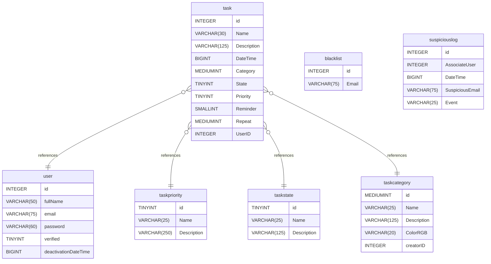

> 💡 **Looking for the live deployment?** This `main` branch contains the original cookie-based architecture. For the version adapted for iOS/Safari compatibility (using `localStorage` and deployed live on Render), please check out the [`portfolio-deployment` branch](https://github.com/GiorgosDen/ToDoListv2BackEnd/tree/portfolio-deployment).

# TaskMaster Backend App (v2)
A REST API built with Node.js and following the MVC (Model-View-Controller) architecture. This backend serves as a core component of the Full-Stack [ToDoList v2 App](https://github.com/GiorgosDen/ToDOListv2).

---
| Part Name | Link | Tech Stack |
| :--- | :--- | :--- |
| **Front-End App** | [View Repo](https://github.com/GiorgosDen/ToDoListv2FrontEnd) | React, TailwindCSS |
| **Back-End API** | `this repo` | Node.js,Express,MySQL |

---

## Tech Stack
* **Runtime:** Node.js
* **Framework:** Express.js
* **Security:** bcrypt (password hashing), JSON Web Tokens (JWT) for authorization, HttpOnly cookie for access to JWT.
* **Email Service:** Nodemailer integrated with Brevo SMTP for reliable transactional email delivery.
* **API Testing:** Thunder Client

---

## Security & Architecture
* **Password Hashing:** User passwords are securely hashed using the bcrypt library.
* **Token-Based Auth:** JSON Web Tokens (JWT) are used for user authorization to protect routes and manage user data.
* **HttpOnly Cookie:** Safe storage and access to JWTs.
* **Unique Identifiers:** User emails and IDs are strictly enforced as unique identifiers.
* **Email Verifications:** Send emails that contain JWTs for: Verify Account, Resend Account Verification, Reset Account Password, Verify Update Account's Email, Cancel Update Account Verification, and Activate Account Again.

---

## Features & Functionalities
### User Management
* **Sign Up:** Public route allowing new users to register in the system (via Verification Email).
* **Resend Sign Up Verification:** Public route allowing new users to receive new sign-up verification (via Email).
* **Reset Password:** Public route allowing the user to recover their account if they forgot their password (via Email). 
* **Login:** Authenticate using an email and password to receive an access JWT.
* **LogOut:** Log out of ToDoListApp (HTTP cookies being cleared).
* **Update:** Protected route allowing authorized users to update their profile information (fullName, password by knowing the current, email via Verification Email).
* **Deregister:** Option to remove a user account from the system.
* **Cancel Deregister:** Option to cancel deregister via email within 24 hours.
### Task Management
* **Daily Task Management:** Real-time state management for creating, completing, updating, and deleting tasks.
* **Task by View Mode and Sort:** View tasks by Day/Week/Month/Total and sort by Time or State.
* **Task Status Engine:** Automatic status calculation (In Progress, Completed, Expired) based on due times.
* **Task Categories:** Organize tasks using system and custom (create, update, delete, owned by users) categories.
* **Task Priorities:** View detailed priority levels for tasks.
### 📊 Task Statistics & Analytics
- **Core Metrics:** Track overall productivity with real-time indicators for **Completed Tasks**, **Total Tasks**, and overall **Completion Rate**.
- **Task by Category:** Visualized via a **Pie Chart** to show the distribution of tasks across different custom and system categories.
- **Completed vs. Total Progress:** Monitored through a dynamic **Line Chart** illustrating productivity trends over time.
- **Task by Priority:** Organized via a **Bar Chart** breaking down tasks by their priority levels (Low, Medium, High).
- **Recent Activity:** Quick-access feed highlighting the **5 newest tasks** added to the system.

---

## Database Stack
### 🗄️ Database Architecture & Local Setup (MySQL)

The backend relies on a relational MySQL database to manage user accounts and persistent application data (such as user tasks). During development, the schema and queries were designed and managed locally using **MySQL Workbench**.

### 📋 Schema Overview
* **`user`**: Manages user accounts, contact details, authentication credentials, verification status, and account deactivation timestamps.
* **`task`**: Stores user tasks, including titles, descriptions, deadline timestamps, reminder settings, and recurrence intervals (the last two are in progress).
* **`taskcategory`**: Defines categories for organizing tasks, including custom names, descriptions, color codes, and ownership(Null for system, User ID for user).
* **`taskstate`**: Tracks task execution states (In Progress, Expired, Completed).
* **`taskpriority`**: Defines priority levels assigned to tasks (e.g., Low, Medium, High).
* **`blacklist`**: Stores blacklisted email addresses to restrict unauthorized user registrations or logins.
* **`suspiciouslog`**: Maintains audit logs for security events, tracking associated users, timestamps, and suspicious activity details.

### 📊 Entity-Relationship Diagram (ERD)

---

## Environment & Configuration
Configuration is managed via **.env** variables for database connections and CORS options.

---
*Developed by Giorgos Den.*

